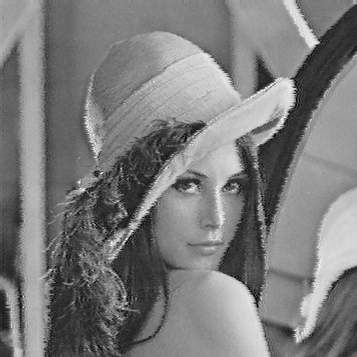

# ADM / DPCM 壓縮實作

## 作業說明

本次作業分為ADM以及DPCM兩個部分，關於實驗要使用的輸入圖以在wiki下載的彩色原圖並以`ChangeToGray.py`處理成灰階圖片，
以便後續實驗使用。若要重現實驗，可以分別在ADM.py,DPCM.py兩個檔案的開始找到設定的區塊，只要修改名字及參數並執行，輸
圖片會存在data資料夾中

## ADM壓縮

ADM壓縮的原始碼可以在`src/ADM.py`裡面查看，參數按照作業要求為(Δ[0], Δmin) = (2,1)、(4,1)、(8,1)、(8,2)

### ADM壓縮算法說明

1. 處理流程

    依作業要求採逐列光柵掃描（每列由左至右、列與列由上至下）。每一列都獨立處理，開頭重新初始化預測器。
初始條件（每列開始時）：

| 變數 | 初始值 |
| --- | --- |
| `predict` | `img[y, 0]`|
| `delta` | Δ[0] |
| `prev_e` | +1 |
2. 編碼(encode)

    對該列第 x = 1 … W−1 個像素:

    1. 計算`e`：`e = img[y,x] − predict`
        - `e ≥ 0` → 輸出 bit 1，令 `e = +1`
        - `e < 0` → 輸出 bit 0，令 `e = −1`
        - 誤差相等判定：誤差剛好為 0 時視為正（輸出 1）
    2. 更新`delta`：
        - 若 `|delta| ≥ Δmin`：`delta = |delta| × (e + 0.5 × prev_e)`
        - 否則：`delta = Δmin × e`
    3. 更新`predict`：`predict = predict + delta`
    4. 記錄`e`：`prev_e = e`
3. 解碼(decode)

    解碼端的出使條件與編碼端完全相同，流程則如下:

    1. 初始化`predict = first_pixel[y]`，`delta = Δ[0]`，`prev_e = +1`
    2. 讀取 bit：`1 → e = +1`，`0 → e = −1`
    3. 以相同公式更新 `delta`，再 `predict += delta`，輸出 `img[y,x] = predict`
    4. `prev_e = e`

### 不同參數的分析

- slope overload
    - 發生位置:快速變換處
    - 視覺表現:邊緣模糊
- granular noise
    - 發生位置:平坦或是緩變區域
    - 視覺表現:平坦區出現細小顆粒雜訊

四組參數分析

- (2,1)

    

- (4,1)

    

- (8,1)

    

- (8,2)

    

- granular noise

    - 前三組參數表現差不多因為其delta_min皆為1，而最後一組參數則因delta_min的上升而有較明顯的表現

- slope overload

    - 前三組參數表顯會較為明顯因為其delta_min較低，而最後一組的表現則會有所改善

## DPCM壓縮
